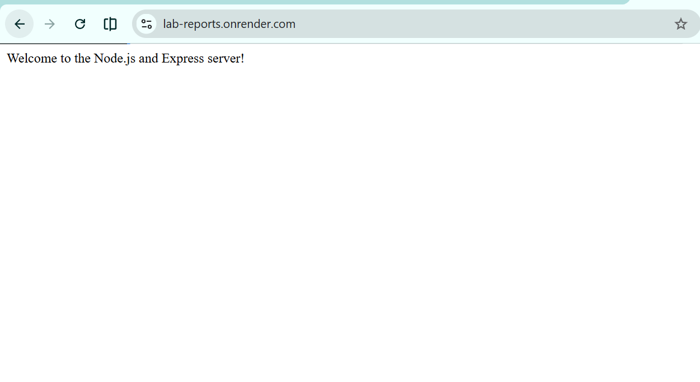
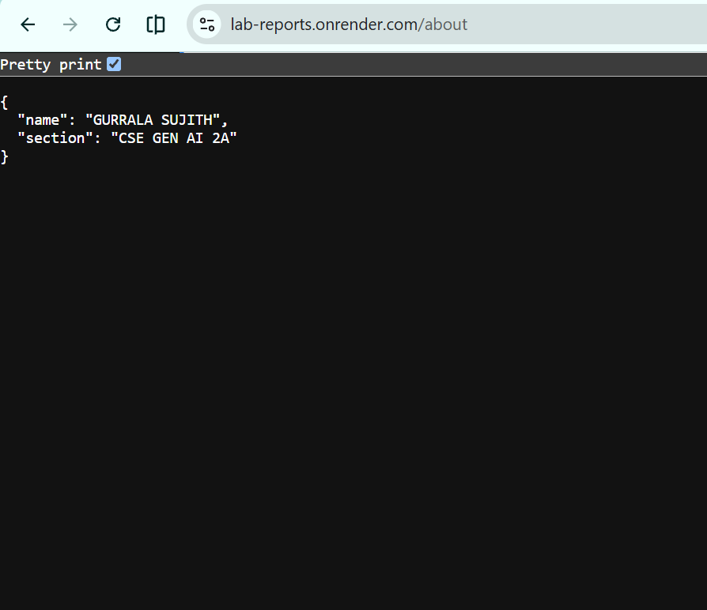
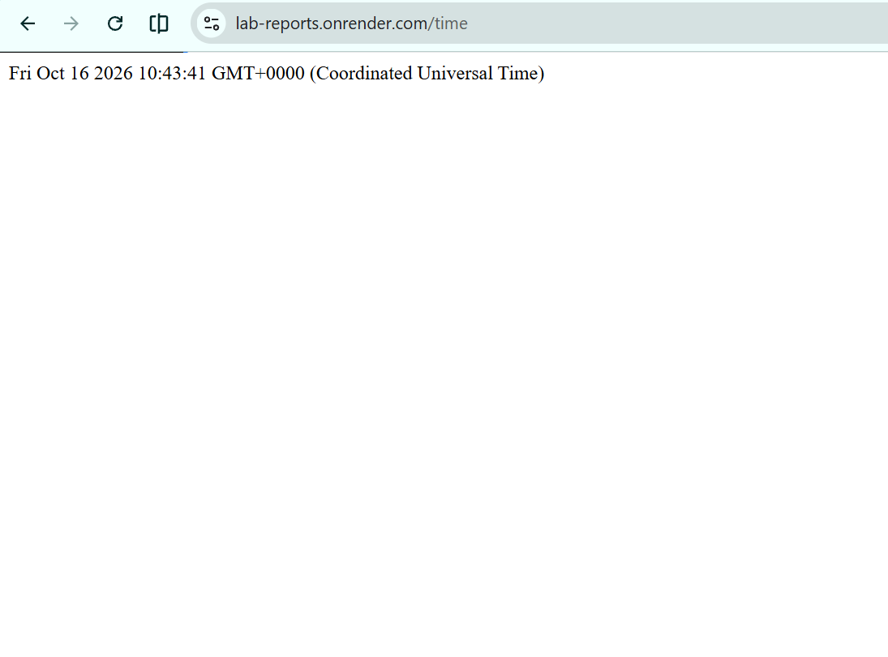
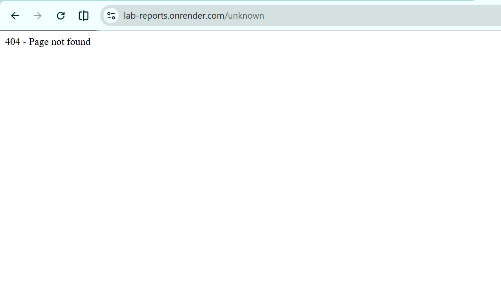

# Lab 1: Node.js and Express server

**Name:** GURRALA SUJITH
**Registration number:** 252U1R9045
**Section:** CSE GEN AI 2A

**Live link:** https://lab-reports.onrender.com

## Objective

Set up a Node.js project and build a small web server, first with Node.js's built-in `http` module and then with Express.js. Add routes, handle unknown paths, and verify the response status codes in a browser.

## How to run

### Prerequisites

- Node.js and npm installed.

### Install dependencies

```bash
npm install
```

### Start the server

```bash
npm start
```

The server listens on port `3000` by default.

### Plain Node.js HTTP server

The file `plain-server.js` demonstrates a basic server using `http.createServer`. To run it instead of the Express server:

```bash
node plain-server.js
```

Stop the running server with `Ctrl+C` before starting the other server, because both use port `3000`.

## `package.json` fields

- **name:** Project/package name.
- **version:** Current project version.
- **description:** Short explanation of the project.
- **main:** Main entry file for the package.
- **scripts:** Short commands that can be run with npm. Here, `npm start` starts `server.js`.
- **keywords:** Search terms that describe the package.
- **author:** Package author.
- **license:** License under which the package is shared.
- **dependencies:** Packages required by the project at runtime, including Express.

## Endpoints

| Method | Path         | Description                                   | Expected status |
| ------ | ------------ | --------------------------------------------- | --------------- |
| GET    | `/`          | Returns a welcome message.                    | `200 OK`        |
| GET    | `/about`     | Returns JSON containing the name and section. | `200 OK`        |
| GET    | `/time`      | Returns the current date and time.            | `200 OK`        |
| Any    | Unknown path | Returns a not-found message.                  | `404 Not Found` |

## Screenshots

Add your screenshots to the `screenshots/` folder and make sure each image filename has **no spaces**. The references below use filenames with hyphens.

### Home route (`GET /`)



### About route (`GET /about`)



### Time route (`GET /time`)



### Unknown route (404)



> Replace the placeholder image references with your actual screenshots. If your screenshot currently has spaces in its filename, rename the file to the matching hyphenated name above.

## Notes: problems faced and how they were solved

- **Port already in use:** Stop the other server process before starting a server on port `3000`.
- **Unknown route:** Added a final fallback handler that responds with status code `404`.
- **Screenshot filenames:** Use filenames without spaces and keep the README paths identical to the actual filenames.

## Viva questions

**1. What is the difference between `package.json` and `node_modules`?**  
`package.json` records project metadata and dependencies. `node_modules` contains the installed packages.

**2. What does `app.listen()` do?**  
It starts the Express application listening for incoming requests on the specified port.

**3. What do `request` and `response` represent?**  
`request` contains information about the incoming HTTP request. `response` is used to send the result back to the client.
