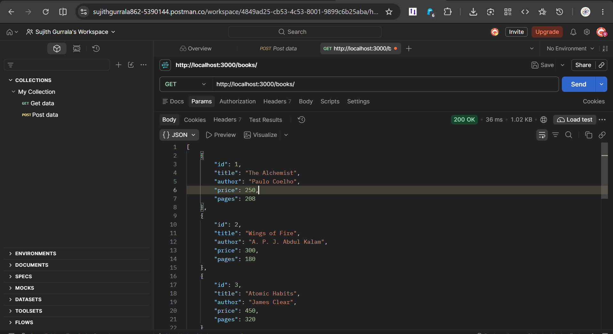
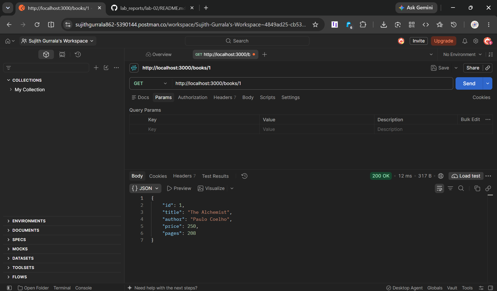
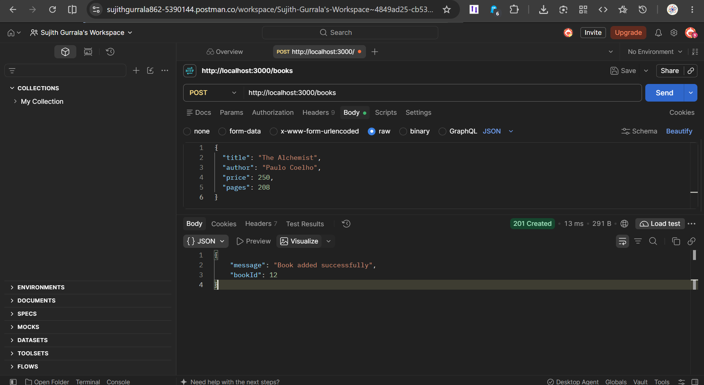
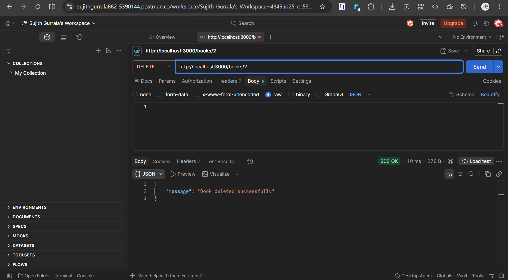
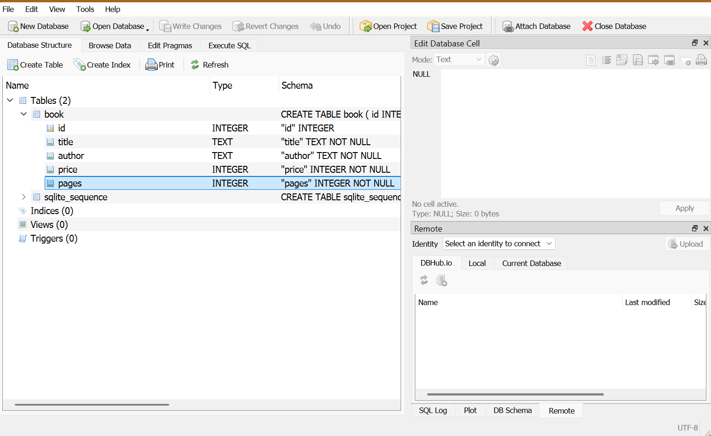

# Lab 2: SQLite database and CRUD routes

**Name:** GURRALA SUJITH  
**Registration number:** 252U1R9045  
**Section:** CSE GEN AI 2A

**Live link:** Not deployed yet

## Objective

Connect an Express server to a SQLite database and perform CRUD operations using HTTP routes. Create a book table, insert sample records, and test all five endpoints using Postman.

## How to run

### Prerequisites

- Node.js and npm installed.
- VS Code installed.

### Install dependencies

Open the terminal in the `lab-02` folder and run:

```bash
npm install
```

### Initialize the database

Run the following command to create the database and insert 10 sample books:

```bash
node seed.js
```

### Start the server

Run the server using nodemon:

```bash
npm run dev
```

The server runs at `http://localhost:3000` by default.

## Database structure

The database file is `books.db`, and the table name is `book`.

| Column | Data type | Description     |
| ------ | --------- | --------------- |
| id     | INTEGER   | Primary key     |
| title  | TEXT      | Book title      |
| author | TEXT      | Book author     |
| price  | INTEGER   | Book price      |
| pages  | INTEGER   | Number of pages |

## Endpoints

| Method | Path              | Description                   | Expected status |
| ------ | ----------------- | ----------------------------- | --------------- |
| GET    | `/books/`         | Returns all books.            | `200 OK`        |
| GET    | `/books/:bookId/` | Returns a book by its ID.     | `200 OK`        |
| POST   | `/books/`         | Adds a new book.              | `201 Created`   |
| PUT    | `/books/:bookId/` | Updates all fields of a book. | `200 OK`        |
| DELETE | `/books/:bookId/` | Deletes a book by its ID.     | `200 OK`        |

### Example POST and PUT request body

Select **Body → raw → JSON** in Postman and enter:

```json
{
  "title": "New Book",
  "author": "Test Author",
  "price": 300,
  "pages": 250
}
```

## Screenshots

### 1. Get all books



### 2. Get one book



### 3. Add a book



### 4. Update a book


### 5. Delete a book



### 6. SQLite database



## Notes: problems faced and how they were solved

- **Database connection:** Used `async/await` to wait for database operations to complete.
- **SQL injection:** Used parameterized queries with `?` placeholders to safely pass user input.
- **Book not found:** Returned `404 Not Found` when a requested book does not exist.
- **Port already in use:** Stopped the other server process before starting the application.
- **Screenshot display:** Used relative image paths and filenames without spaces.
- **GitHub submission:** Added `.gitignore` to exclude `node_modules` and `.env`.

## Viva questions

**1. Why do we use `await` for database calls?**

It waits for a database operation to complete before executing the next dependent operation.

**2. What is SQL injection, and how do placeholders prevent it?**

SQL injection is an attack where malicious input changes a SQL query. Parameterized queries keep user input separate from SQL commands.

**3. When is PUT used instead of POST?**

POST is used to create a new resource, while PUT is used to update an existing resource.

**4. What are CRUD operations?**

CRUD stands for Create, Read, Update, and Delete.

**5. Why do we use SQLite?**

SQLite is a lightweight relational database that stores data in a file and does not require a separate database server.

## Submission

- Upload the `lab-02` folder to the course GitHub repository.
- Include `server.js`, `seed.js`, `books.db`, `package.json`, `.gitignore`, and `README.md`.
- Include all six screenshots in the `screenshots/` folder.
- Do not commit `node_modules` or `.env`.
- Add the public deployment URL after successfully deploying the backend. If deployment is not possible, explain why and provide screenshots of all five endpoints.
