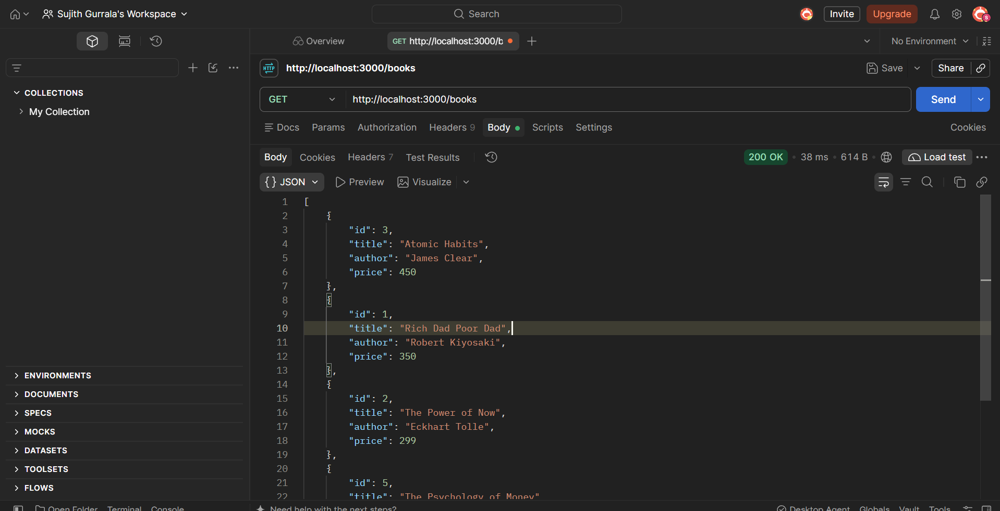
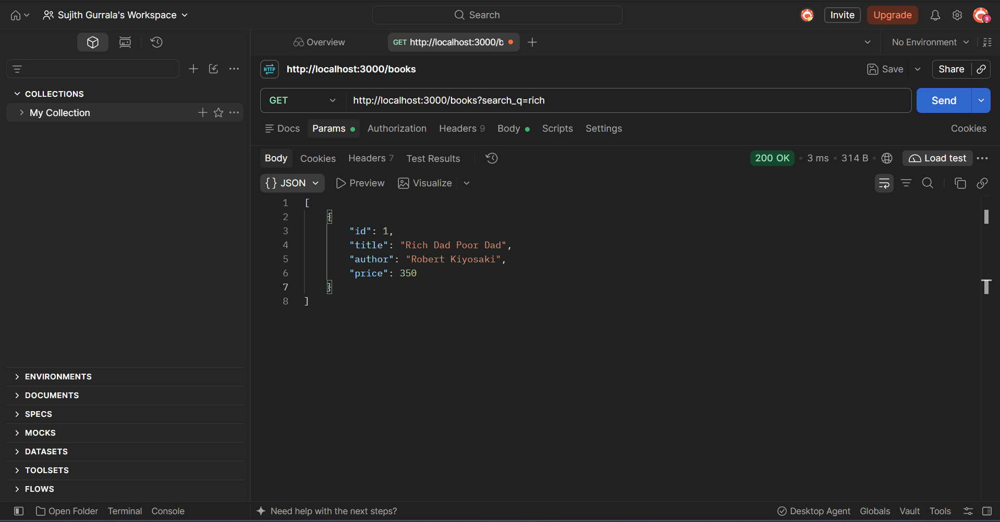
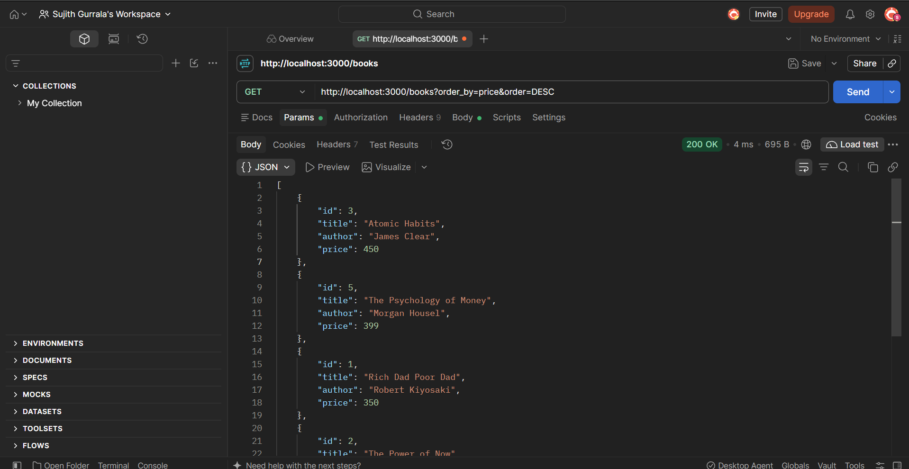
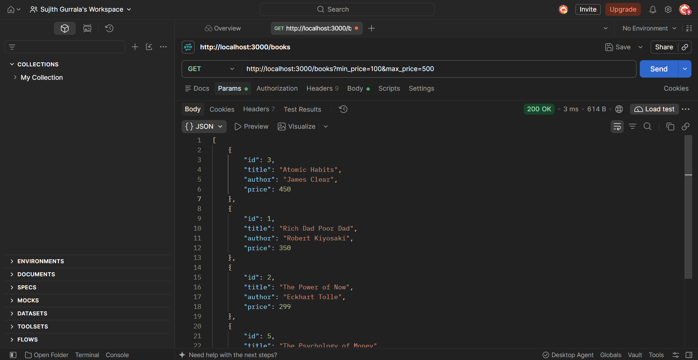
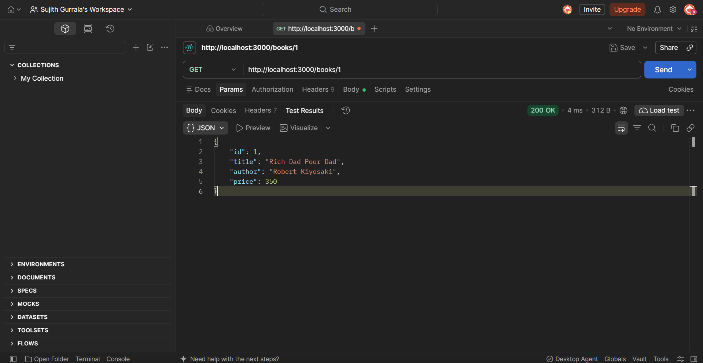
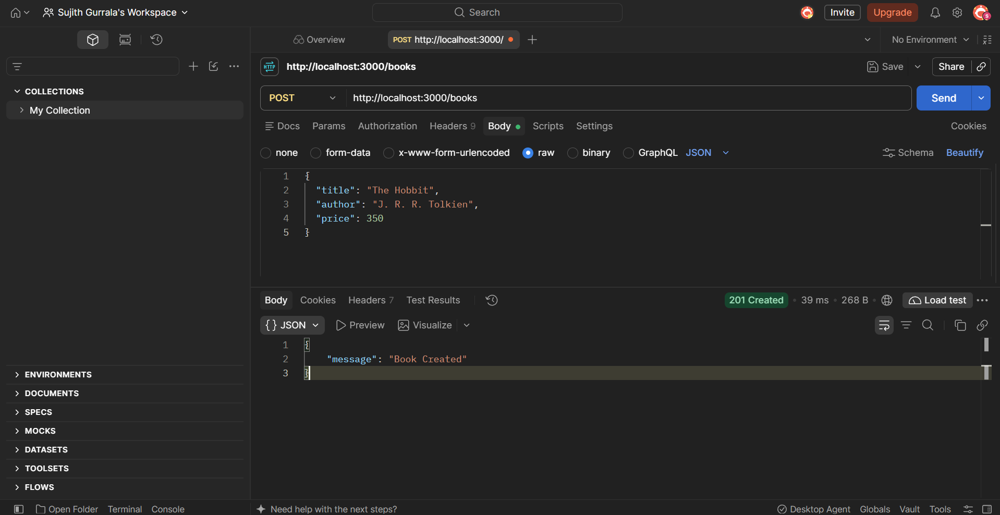
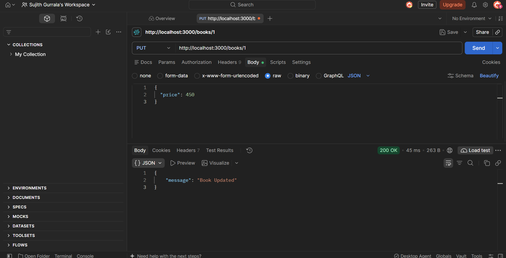
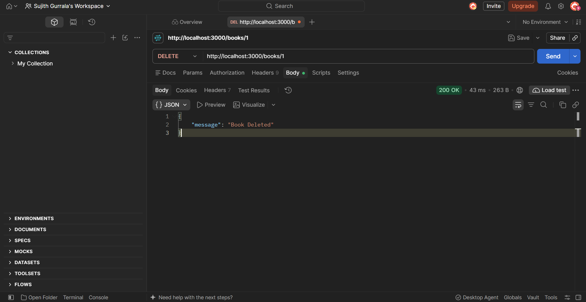
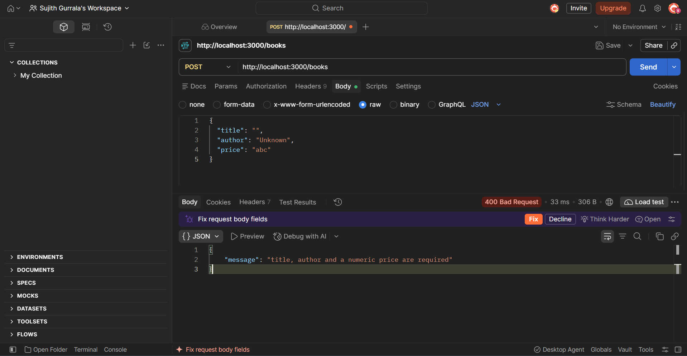
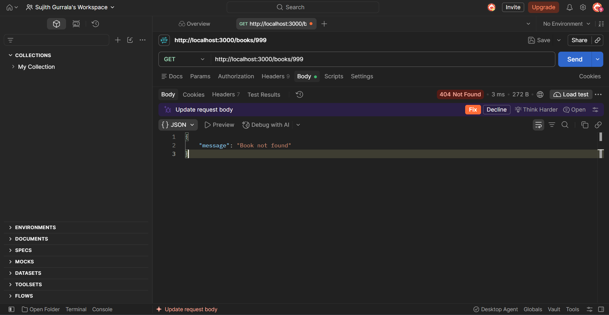

# Lab 3: REST API, query parameters, validation, debugging

**Name:** GURRALA SUJITH  
**Registration number:** 252U1R9045  
**Section:** CSE GEN AI 2A

**Live link:** Not deployed yet

## Objective

Develop REST APIs using Express.js and SQLite. Implement search, sorting, pagination, price filtering, request validation, and proper HTTP status codes. Test all endpoints and handle common errors.

## How to run

### Prerequisites

- Node.js and npm installed.
- VS Code installed.

### Install dependencies

Open the terminal in the `lab-03` folder and run:

```bash
npm install
```

### Start the server

Run the following command:

```bash
npm start
```

The server runs at `http://localhost:3000` by default.

The database file `books.db` and the `books` table are created automatically when the server starts.

## Database structure

The database file is `books.db`, and the table name is `books`.

| Column | Data type | Description |
|---|---|---|
| id | INTEGER | Primary key |
| title | TEXT | Book title |
| author | TEXT | Book author |
| price | REAL | Book price |

## Endpoints

| Method | Path | Description | Expected status |
|---|---|---|---|
| GET | `/books` | Returns books with search, sorting and filters. | `200 OK` |
| GET | `/books/:bookId` | Returns a book by its ID. | `200 OK` |
| POST | `/books` | Adds a new book after validation. | `201 Created` |
| PUT | `/books/:bookId` | Updates book details. | `200 OK` |
| DELETE | `/books/:bookId` | Deletes a book by its ID. | `200 OK` |

## GET query parameters

The GET `/books` API supports the following query parameters:

| Parameter | Description | Default value |
|---|---|---|
| `search_q` | Searches books by partial title. | Empty string |
| `order_by` | Column used for sorting. | `title` |
| `order` | Sorting order (ASC/DESC). | `ASC` |
| `limit` | Maximum number of records. | `10` |
| `offset` | Number of records to skip. | `0` |
| `min_price` | Minimum book price. | Optional |
| `max_price` | Maximum book price. | Optional |

### Example URLs

```text
http://localhost:3000/books

http://localhost:3000/books?search_q=Harry

http://localhost:3000/books?order_by=price&order=DESC

http://localhost:3000/books?limit=5&offset=0

http://localhost:3000/books?min_price=100&max_price=500
```

## Example POST and PUT request body

Select **Body → raw → JSON** in Postman and enter:

```json
{
  "title": "The Hobbit",
  "author": "J. R. R. Tolkien",
  "price": 350
}
```

## Validation

The POST API checks whether:

- Title is provided.
- Author is provided.
- Price is provided and numeric.

If the input is invalid, the API returns `400 Bad Request` with a clear error message.

## HTTP status codes

| Status code | Description |
|---|---|
| `200` | Request successful |
| `201` | Book successfully created |
| `400` | Invalid request data |
| `404` | Book or route not found |

## Screenshots

### 1. Get all books



### 2. Search books by title



### 3. Sort books



### 4. Filter books by price range



### 5. Get a book by ID



### 6. Add a new book



### 7. Update book details



### 8. Delete a book



### 9. Validate incorrect input



### 10. Handle book not found



## Notes: problems faced and how they were solved

- **Database connection:** Used `async/await` to wait for database operations to complete.
- **SQL injection:** Used parameterized queries with `?` placeholders to safely pass user input.
- **Invalid input:** Added validation to check missing title, author and non-numeric price.
- **Book not found:** Returned `404 Not Found` when a requested book does not exist.
- **Port conflict:** Fixed the `EADDRINUSE` error by stopping the other server process.
- **Table name error:** Corrected the table name in SQL queries.
- **Missing await:** Used `await` for database operations.
- **GitHub submission:** Added `.gitignore` to exclude `node_modules`, `.env` and the database file.

## Viva questions

**1. What is the difference between query parameters and path parameters?**

Query parameters are used to filter or search data in a URL. Path parameters are used to identify a specific resource.

**2. What is a REST API?**

A REST API allows applications to communicate using HTTP methods such as GET, POST, PUT and DELETE.

**3. What does stateless mean?**

Stateless means each request is handled independently without depending on previous requests.

**4. Which status code is used for invalid input?**

`400 Bad Request` is used when the client sends invalid data.

**5. Which status code is used when a book does not exist?**

`404 Not Found` is used when the requested book cannot be found.

**6. Why do we use parameterized queries?**

Parameterized queries prevent SQL injection by keeping user input separate from SQL commands.

**7. What is the purpose of LIMIT and OFFSET?**

LIMIT specifies the maximum number of records to return, while OFFSET specifies how many records to skip.

## Submission

- Upload the `lab-03` folder to the course GitHub repository.
- Include `app.js`, `package.json`, `.gitignore` and `README.md`.
- Include all 10 screenshots in the `screenshots/` folder.
- Do not commit `node_modules`, `.env` or the generated database file.
- Add the public deployment URL after successfully deploying the backend.
- If deployment is not possible, explain why and provide Postman screenshots of all endpoints.